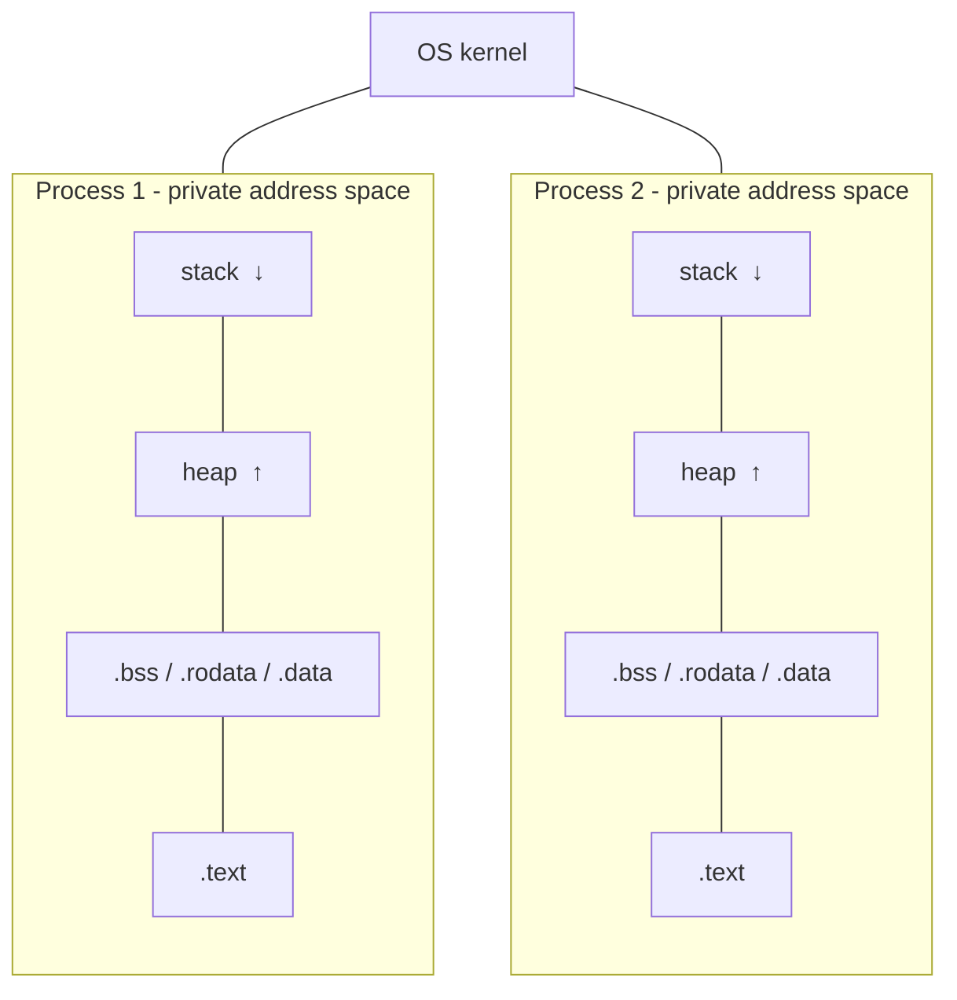
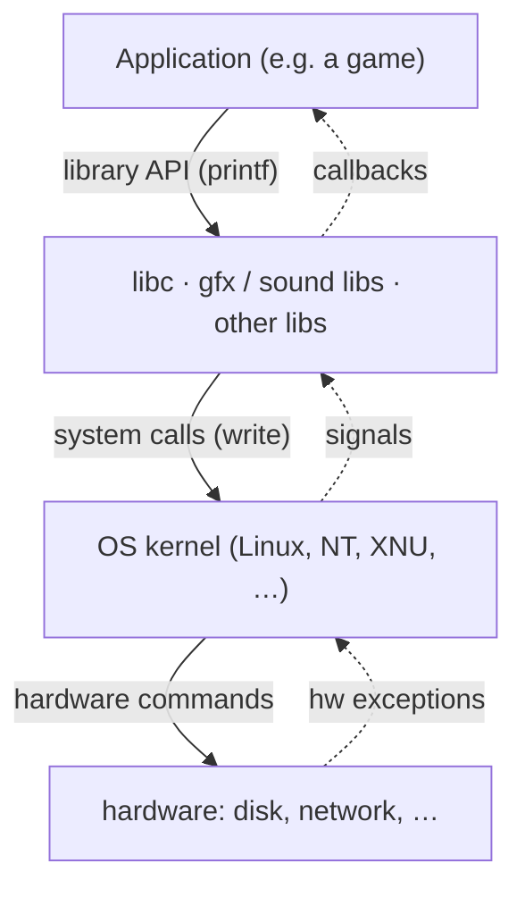
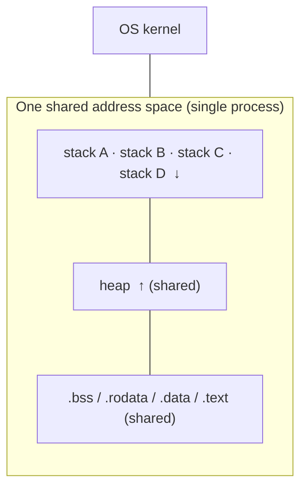
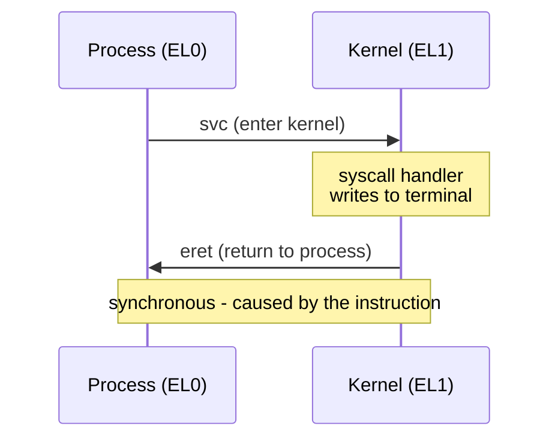
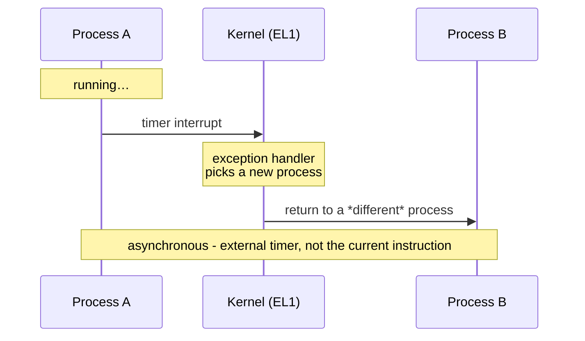
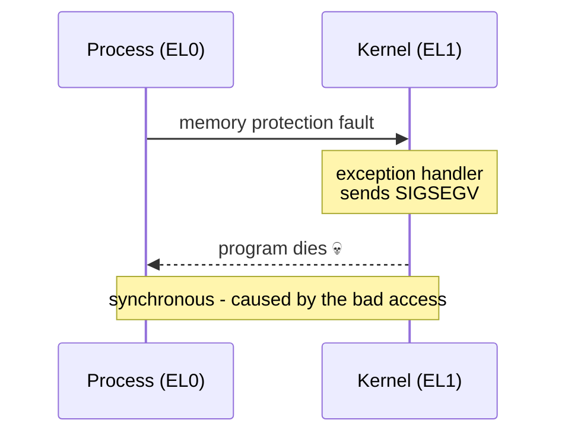

### Table of Contents

---
- The process abstraction
- OS Kernel
- Processes vs Threads
- Time Sharing & Context Switching
- Process Creation
- Zombie Processes
- Signals
- Hardware Exceptions
- How it all connects

### 1. The Process Abstraction

---

A **process** is a running instance of a program.

How can dozens of programs appear to run at once on limited hardware?

**Virtualization** - the OS gives each process the illusion it owns the entire machine.

Each process gets:

- its own virtual address space (private memory)
- its own logical control flow (its own CPU)
- a unique process ID (PID)



### 2. OS Kernel

---

The kernel makes this illusion possible. It's the heart of the OS, sitting between your programs and bare metal, and its job is to manage everything:

- provide abstractions over hardware: virtual memory, processes, files, sockets
- schedule processes on the CPU
- control access to hardware devices (disk, network)



*(The CPU & memory sit alongside every layer - instructions execute on the CPU regardless of which layer issued them.)*

Programs interact with the kernel two ways:

- **System calls** - a program asks the kernel for something (e.g. the `write` syscall)
- **Signals** - the kernel notifies a process that something happened (e.g. a child died)

Two key properties:

- **always resident** - it lives in every process's address space
- **elevated privilege** - it can do what regular programs can't, like directly accessing hardware or switching page tables

### 3. Processes vs Threads

---

**Processes** have their own address space *and* their own control flow, so they're fully isolated - one process can't touch another's memory.

**Threads** are "lightweight processes": they share a single address space but each has its own control flow (and its own stack). Threads in the same program see the same memory but execute independently.



|  | Virtual Address Space | Control Flow |
| --- | --- | --- |
| Processes | Own | Own |
| Threads | Shared | Own |

*Logical control flow* = the sequence of instructions a thread is executing, defined by its stack pointer and registers.

### 4. Time Sharing & Context Switching

---

**Time-sharing** is how the OS creates the illusion of many programs running at once: it switches between processes on the CPU, giving each a small slice of time, fast enough to look simultaneous.

The trigger is a **hardware timer interrupt** firing periodically, forcing the CPU back into the kernel so it can schedule another process.

A **context switch** - when the OS switches from one process to another:

1. interrupt the currently running process
2. save its architectural state (registers, stack pointer) to memory
3. pick another process to run
4. restore that process's previously saved state
5. run it

On a single CPU processes don't truly run in parallel - time-sharing and context switching just make it look that way.

### 5. Process Creation

---

`fork` - **duplicating a process.** Creates a new process as an exact copy of the caller.

```c
pid_t fork(void);

int main() {
    pid_t p = fork();
    if (p == 0) {
        // only child runs this
    } else {
        // only parent runs this
    }
}
```

- returns the child's PID to the parent, `0` to the child
- child starts from the same point (right after `fork`), with its own copy of the address space
- the order parent and child execute in is undefined

`waitpid` - **waiting for children.**

```c
pid_t waitpid(pid_t pid, int *wstatus, int options);
```

- parent calls this to wait for a child to finish; returns the child's PID when done
- exit details come back via `wstatus`
- pass `-1` to wait for any child
- `WNOHANG` - return immediately if no child has exited yet

`execve` - **running a different program.** `fork` only duplicates; `execve` replaces the current process's address space with a new program.

```c
int execve(const char *pathname, char *const argv[], char *const envp[]);
```

- does not return on success (the program has been replaced)
- takes the program path, command-line arguments, and environment variables

To spawn a completely new program, combine both - **fork then execve**:

```c
int main() {
    char *args[] = { "/bin/echo", "hello", "world", NULL };
    pid_t p1 = fork();
    if (p1 == 0) {
        execve("/bin/echo", args, environ); // child becomes echo
    } else {
        waitpid(p1, NULL, 0); // parent waits
        printf("child exited\n");
    }
}
```

### 6. Zombie Processes

---

When a child process exits, it enters a **zombie** state:

- no longer running
- still exists in the process table
- waiting for the parent to acknowledge its death

It stays a zombie until the parent calls `waitpid` to **reap** it. Always reap dead children - zombies waste resources and clutter the process table.

```c
int main() {
    pid_t p = fork();
    if (p == 0) {
        printf("child exiting\n"); // child dies here
    } else {
        while(1); // parent never calls waitpid!
    }
}
```

Here the child becomes a zombie - it shows up as `<defunct>` in `ps`.

If the parent dies before reaping, the children are **adopted by `init`** (PID 1), which reaps them automatically.

### 7. Signals

---

A **signal** is a small, asynchronous notification the kernel sends to a process. It can be triggered by hardware exceptions (segfault → `SIGSEGV`) or user actions (Ctrl+C → `SIGINT`).

**Sending** - one process signals another via the `kill` syscall:

```c
$ kill -KILL 508315   # send SIGKILL to process 508315
```

**Catching** - a process can register a handler that runs when a signal arrives:

```c
void my_handler(int signo) {
    // handle the signal
}

struct sigaction act;
act.sa_handler = my_handler;
act.sa_flags = SA_RESTART;
sigemptyset(&act.sa_mask);
sigaction(SIGCHLD, &act, NULL);
```

The kernel interrupts the process, runs the handler, then returns control. `SIGKILL` and `SIGSTOP` can never be caught - the kernel always handles them directly.

**Blocking** - a common fork pattern to avoid a race where the child dies before the parent records it:

1. block `SIGCHLD` before forking
2. add the child to your list in the parent
3. unblock

```c
sigset_t mask;
sigemptyset(&mask);
sigaddset(&mask, SIGCHLD);

sigprocmask(SIG_BLOCK, &mask, NULL);   // block SIGCHLD
// ... do sensitive work ...
sigprocmask(SIG_UNBLOCK, &mask, NULL); // unblock
```

| Signal | Number | Meaning |
| --- | --- | --- |
| SIGINT | 2 | Ctrl+C in terminal |
| SIGKILL | 9 | Force kill (cannot be caught) |
| SIGSEGV | 11 | Segmentation fault |
| SIGTERM | 15 | Politely ask program to terminate |
| SIGCHLD | 17 | Child process state changed |
| SIGSTOP | 19 | Suspend execution (cannot be caught) |


- **Not queued** - if several children die at once you might get only one `SIGCHLD`, so a handler must loop with `WNOHANG` to reap them all:
  ```c
  while (waitpid(-1, NULL, WNOHANG) != -1);
  ```
- **Not all functions are signal-safe** - signals interrupt mid-execution, and many libc functions (like `printf`) aren't safe. In a handler use only signal-safe functions (e.g. `write` instead of `printf`).
- **Data races** - a signal can arrive while you're updating shared state; block it with `sigprocmask` around the critical section.

### 8. Hardware Exceptions

---

A **hardware exception** is how the CPU handles unexpected events: it interrupts the running program and transfers control to an exception handler in the kernel. This involves the CPU and OS directly.

Software exceptions (e.g. a Java `throw`) are different - they're just a non-local *jump within the same program*, with no special HW/OS involvement.

**Privilege levels** - handlers need more power than regular programs, so the CPU enforces:

- **`EL0`** - regular applications
- **`EL1`** - OS kernel

Some instructions and memory pages are only accessible at `EL1`; touching them from `EL0` faults.

**Two types of exceptions:**

1. **Synchronous** - caused by the instruction being executed: illegal instruction, misaligned access, page fault, system call (`svc` on arm64)
2. **Asynchronous** - caused by external events: key press, network packet, hardware timer (which triggers context switches)

**Examples**

Example 1 - `write` system call (**synchronous**):



Example 2 - context switch (**asynchronous**):



Example 3 - illegal memory access (**synchronous**):



**ARM64 mechanics**

`svc` (entering the kernel):

1. save the current PC into `ELR_EL1`
2. save CPU state into `SPSR_EL1`
3. save exception details into `ESR_EL1`
4. mask further interrupts
5. jump to the exception handler
6. raise privilege to EL1

`eret` (returning from the kernel):

1. restore CPU state from `SPSR_EL1`
2. jump back to `ELR_EL1`
3. lower privilege back to EL0

**Debugger breakpoints** also ride on exceptions:

- **Hardware** - set a CPU control register (e.g. `DBGBVR0`) to the breakpoint address; when PC reaches it, an exception fires and the debugger takes over. Watchpoints work the same way.
- **Software** - replace the instruction at the breakpoint with a trap instruction (e.g. `HLT`); when it executes, an exception fires.

### 9. How it all connects

---

Hardware exceptions are the bare-metal foundation: system calls enter the kernel through them, context switches are triggered by timer exceptions, and signals are delivered as a result of them.

```c
Hardware Exception
        ↓
   OS Kernel (EL1)
        ↓
  ┌─────┴──────┐
System     Context
 Calls      Switch
  ↓             ↓
Signals     New Process
  ↓
Signal Handler
(user code, EL0)
```
